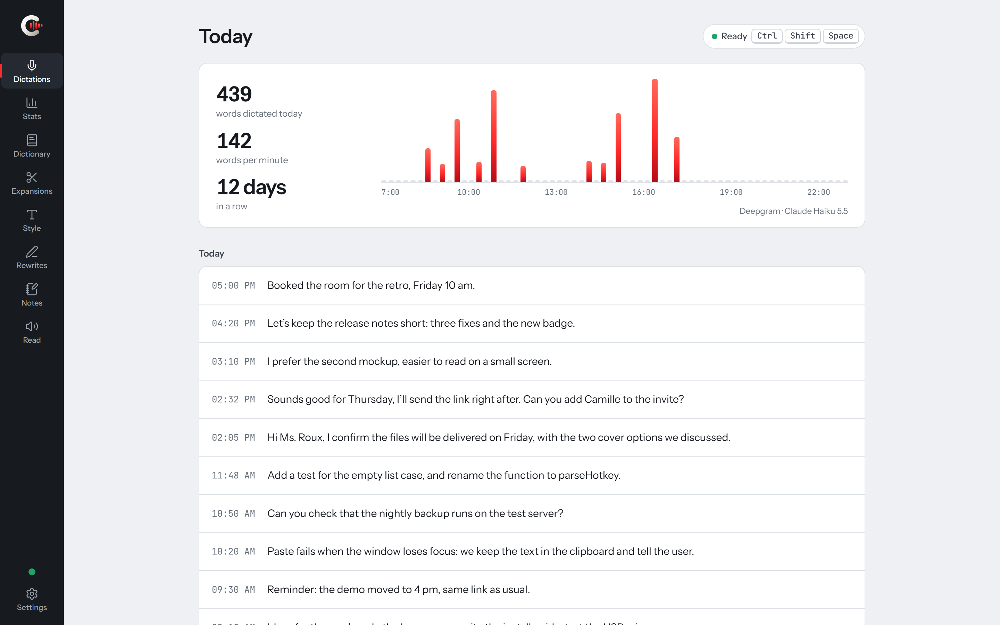
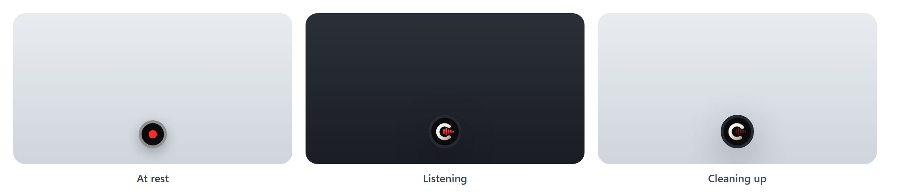

<p align="center">
  <picture>
    <source media="(prefers-color-scheme: dark)" srcset=".github/assets/cyphed-mark-dark.svg">
    
  </picture>
</p>

<h1 align="center">Cyphed</h1>

<p align="center"><b>Dictée vocale pour Windows. Tu parles, un texte propre arrive là où est ton curseur.</b></p>

<p align="center">
  
</p>

<p align="center"><a href="README.md">Read in English</a></p>

Tu tiens un raccourci, tu parles, tu relâches. Cyphed transcrit ta voix, enlève les hésitations, corrige la ponctuation et la grammaire sans te réécrire, et colle le résultat dans l'application au premier plan : un mail, Slack, un éditeur de code, une conversation avec un assistant IA. Il tourne en arrière-plan avec un petit badge flottant et garde un historique de tout ce que tu as dicté.

Je l'ai construit pour moi, pour avoir un outil de dictée que je peux lire, corriger et faire évoluer, et je m'en sers tous les jours.

<p align="center">
  
</p>

## Ce qu'il fait

- **Dicter partout** : raccourci clavier ou bouton de souris, maintenir ou bascule, appui bref pour les mains libres. Échap annule.
- **Un texte propre, pas réécrit** : une passe de Claude Haiku nettoie la transcription, ou le modèle compatible OpenAI de ton choix (DeepSeek, OpenCode Go, OpenRouter, ou un modèle local avec Ollama ou LM Studio). Un contrôle local refuse ce qui ressemble à une réponse, une traduction ou un nombre changé, et garde alors la transcription brute.
- **Sait où tu écris** : lit le texte autour du curseur (UI Automation de Windows) pour bien raccorder la phrase, adapte le ton selon l'appli (mail, message, code), ne lit jamais un champ mot de passe.
- **Tes mots** : dictionnaire perso, abréviations, et il apprend des corrections faites dans l'historique.
- **Transformations** : « Peaufiner », « Écrire un prompt » ou tes propres consignes sur le texte sélectionné, par raccourci ou après chaque dictée. Un mode commande applique une consigne dictée à ta sélection.
- **Lire** : une sélection ou une zone de l'écran, lue, résumée ou expliquée, avec une voix française locale qui marche hors ligne.
- **Aucune dictée perdue** : si le réseau coupe, l'audio est gardé 7 jours et un clic la refait.
- **Statistiques** : mots par jour, mots par minute, séries, applis où tu dictes.
- **Interface en français et en anglais.**

## Ce qui sort de ta machine

| Donnée | Envoyée à |
|---|---|
| Audio d'une dictée | Ton moteur de transcription (Deepgram par défaut, ElevenLabs ou Mistral Voxtral) |
| Texte dicté, texte autour du curseur, dictionnaire | Anthropic (Claude Haiku) pour le nettoyage, ou le fournisseur compatible OpenAI que tu as choisi (rien ne sort avec un modèle local). Jamais le nom de l'appli ni le titre de la fenêtre. La lecture du contexte se coupe dans Réglages |
| Texte à lire | Rien avec la voix locale ; Mistral ou ElevenLabs si tu les choisis |
| Clés, historique, audio, notes | Restent sur ton PC (`%APPDATA%\cyphed`). Aucune télémétrie |
| Recherche de mise à jour | GitHub, quelques fois par jour, pour télécharger les nouvelles versions publiées ici |

Liste complète : [SECURITY.md](SECURITY.md).

## Démarrer

Il faut Windows 10 ou 11, [Node.js](https://nodejs.org) 22.5 ou plus, une clé [Deepgram](https://deepgram.com) (transcription) et une clé [Anthropic](https://console.anthropic.com) (nettoyage ; sans elle, Cyphed colle la transcription brute).

```powershell
git clone https://github.com/bendee1/cyphed.git
cd cyphed
npm install
npm run dev
```

Ouvre **Réglages** dans le Hub, colle tes clés, puis appuie sur `Ctrl + Maj + Espace` dans n'importe quel champ de texte et parle. Les clés peuvent aussi venir des variables d'environnement `DEEPGRAM_API_KEY` et `ANTHROPIC_API_KEY`.

Construire l'application et l'installeur (non signés : SmartScreen avertit) : `npm run dist`. La première fois, la voix hors ligne est préparée (environ 1 Go, il faut [uv](https://docs.astral.sh/uv/)).

## Développement

`npm run check` (types, build, tests), `npm run ui:preview` (l'interface dans un navigateur avec des données d'exemple, sans clé). Architecture : [docs/architecture.md](docs/architecture.md). Contribuer : [CONTRIBUTING.md](CONTRIBUTING.md).

## Licence

[GPL-3.0](LICENSE). Le nom et le logo font partie de l'identité du projet : merci de ne pas publier un fork sous le même nom.
