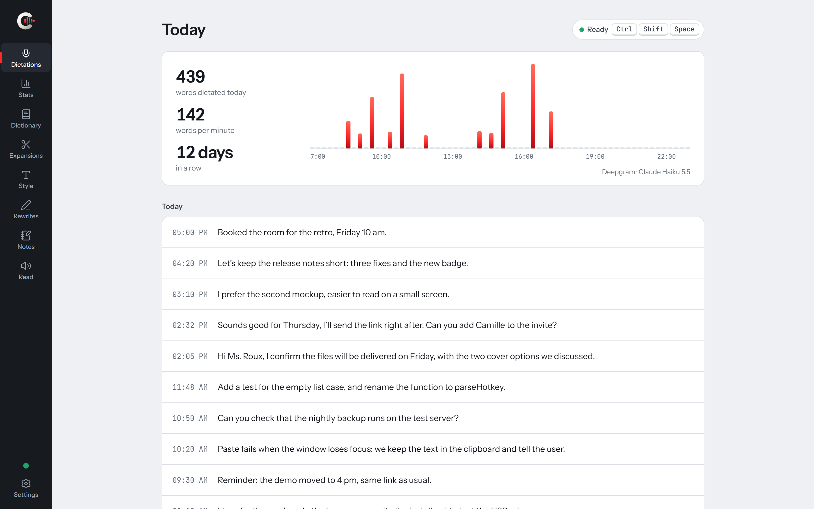
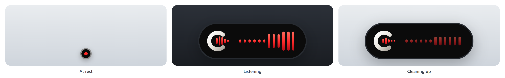
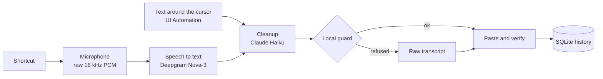

<p align="center">
  <picture>
    <source media="(prefers-color-scheme: dark)" srcset=".github/assets/cyphed-mark-dark.svg">
    
  </picture>
</p>

<h1 align="center">Cyphed</h1>

<p align="center"><b>Voice dictation for Windows. Talk, and clean text appears where your cursor is.</b></p>

<p align="center">
  <a href="https://github.com/bendee1/cyphed/actions/workflows/ci.yml"></a>
  
  <a href="LICENSE"></a>
</p>

<p align="center">
  
</p>

<p align="center"><a href="README.fr.md">Lire en français</a></p>

Hold a shortcut, speak, let go. Cyphed transcribes your voice, removes the filler words, fixes punctuation and grammar without rewriting you, and pastes the result into whatever app has focus: an email, Slack, a code editor, a chat with an AI assistant. It runs in the background with a small floating badge, and keeps a searchable history of everything you dictated.

I built it for myself, to have a dictation tool I can read, fix and extend, and I use it every day.

<p align="center">
  
</p>

## Features

- **Dictate anywhere.** Keyboard shortcut or mouse button, hold-to-talk or toggle, a short press for hands-free. Escape cancels.
- **Clean text, not a rewrite.** One pass of Claude Haiku cleans the transcript, or any OpenAI-compatible model you pick (DeepSeek, OpenCode Go, OpenRouter, or a local model through Ollama or LM Studio). A local output guard rejects anything that looks like an answer, a translation or a changed number, and falls back to the raw transcript instead.
- **Knows where you write.** Reads the text around your cursor (Windows UI Automation) so new text joins the sentence correctly, adapts the tone per app (email, chat, code), never reads password fields.
- **Your words.** Personal dictionary, expansions (type less, say a trigger), and it learns from the corrections you make in the history.
- **Rewrites.** Apply "Polish", "Write a prompt" or your own instructions to the selected text with a shortcut, or after every dictation. A voice command mode applies a spoken instruction to your selection.
- **Read aloud.** Select text or a screen area: Cyphed reads it, summarizes or explains it, with Mistral voices (French Marie, Manon, Léa, Camille and many more) or ElevenLabs.
- **Never loses a dictation.** If the network drops, the audio is kept for 7 days and one click retries it.
- **Stats.** Words per day, words per minute, streaks, which apps you dictate in.
- **French and English** interface.

## How it works



Electron + React + TypeScript, no UI framework, plain CSS. The main process owns the keys, the microphone stream, the Win32 calls (paste, focus) and SQLite. Each window (dictation badge, hub, screen capture) gets its own sandboxed preload with only the calls it needs, and every IPC handler checks which window is calling. Two small C# helpers: one reads the focused text field through UI Automation, the other holds the global mouse hook outside the main thread. Details in [docs/architecture.md](docs/architecture.md).

From the end of speech to the pasted text: about 1.3 s on my PC (transcript finalization ~0.25 s, cleanup ~1.2 s at p50).

## What leaves your machine

Cyphed is local-first, and only talks to the services you configure:

| Data | Sent to |
|---|---|
| Audio of a dictation | Your speech-to-text engine (Deepgram by default, or ElevenLabs, or Mistral Voxtral) |
| Dictated text, the text around the cursor, your dictionary | Anthropic (Claude Haiku) for cleanup, or the OpenAI-compatible provider you chose (nothing leaves the PC with a local model). Never the app name or window title. Turn context reading off in Settings |
| Text to read aloud | Mistral or ElevenLabs, the voice you pick |
| Keys, history, audio, notes | Stay on your PC (`%APPDATA%\cyphed`). No telemetry |
| Version check | GitHub, a few times a day, to download updates from this repository's releases |

Full list in [SECURITY.md](SECURITY.md).

## Get started

Requirements: Windows 10 or 11, [Node.js](https://nodejs.org) 22.5 or later, a [Deepgram](https://deepgram.com) API key (speech to text) and an [Anthropic](https://console.anthropic.com) API key (cleanup; without it, an OpenAI-compatible model set in Settings or a Cerebras key takes over, and with none of them Cyphed pastes the raw transcript).

```powershell
git clone https://github.com/bendee1/cyphed.git
cd cyphed
npm install
npm run dev
```

Open **Settings** in the hub, paste your keys, then press `Ctrl + Shift + Space` in any text field and talk. Keys can also come from the `DEEPGRAM_API_KEY` and `ANTHROPIC_API_KEY` environment variables. They are stored in `%APPDATA%\cyphed\secrets.json` and never sent to the windows.

Build the Windows app and installer (unsigned, so SmartScreen will warn):

```powershell
npm run dist
```

Optional, when running from source: `npm run build:voice` prepares an offline French voice (about 1 GB, needs [uv](https://docs.astral.sh/uv/)). It is not part of the installer; the installed app uses it too when `CYPHED_VOICE_DIR` points to it.

## Development

| Command | What it does |
|---|---|
| `npm run dev` | Run the app with hot reload |
| `npm run check` | Type check, build and run the tests |
| `npm run ui:preview` | Open the interface in a browser with sample data, no keys needed |
| `npm run dist` | Build the installer in `release/` |

The project is organized by process: `src/main` (Electron main process, services and providers), `src/preload` (one bridge per window), `src/renderer` (hub, dictation badge, capture), `src/shared` (types, IPC contract, translations), `tests` (Node test runner, pure logic). See [CONTRIBUTING.md](CONTRIBUTING.md).

## License

[GPL-3.0](LICENSE). The logo and name are part of the project identity; please don't ship a fork under the same name.
